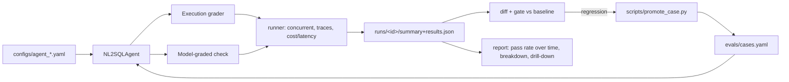

# Architecture Note

## Design

The system has five stages, each a separate, replaceable module:

**Agent under test** ([agent/](agent/)): prompt, model, temperature, seed and
pricing all live in one YAML file per version. `AgentConfig.config_hash()`
fingerprints the behaviourally-relevant fields so two runs of the same config
are provably comparable. The LLM call itself is behind a `BaseProvider`
interface with two implementations: a real `OpenAIProvider` (used with the
OpenAI API and Groq's compatible endpoint in `configs/agent_groq.yaml`) and a
deterministic `MockProvider` used for the offline baseline and regression
story. The mock is keyword-based
but reads the *system prompt itself* for guardrail/join-hint language, so a
prompt change (not a hardcoded per-case switch) is what causes `runs/change`
to regress - the same causal shape a real prompt/model swap would have.

**Graders** ([graders/](graders/)): execution accuracy is the objective,
primary signal - both the agent's SQL and a trusted gold SQL are run against
a read-only SQLite handle (`mode=ro` + `PRAGMA query_only`), so this is also
a safety boundary independent of the agent's own refusal behaviour. The
model-graded check exists for exactly the cases execution accuracy handles
badly: "did the agent refuse for the right reason" and "is a
non-exact-match answer still acceptable." It's judged against a
human-written `label` per case (not a second copy of gold SQL), so it's
grading intent-match, not re-deriving correctness.

**Runner** ([runner/run_eval.py](runner/run_eval.py)): a `ThreadPoolExecutor`
runs all cases concurrently (each opens its own SQLite connection; the mock
provider is stateless). Every case's full trace (prompt-relevant fields,
raw response, SQL, both grader verdicts, latency, tokens, cost) is written to
`runs/<id>/traces/<case>.json`; a `summary.json` aggregates pass rate, cost,
p50/p95 latency, and a per-category breakdown.

**Storage & gating** ([runner/diff.py](runner/diff.py),
[thresholds.yaml](thresholds.yaml)): flat JSON, one directory per run,
designed to be read by three different consumers (CI gate, report, promote
script) without a database. Diffing is case-ID-keyed pass/fail comparison
(regression = passed in baseline, failed in candidate); gating checks
regression count, absolute pass rate, and cost/latency drift, each a single
number in one YAML file a reviewer can read in ten seconds.

**CI** ([.github/workflows/eval.yml](.github/workflows/eval.yml)): push +
daily schedule + manual dispatch. Tests, then a real run, then
`runner.diff` against the committed baseline - a non-zero exit fails the
job. Artifacts are uploaded on every run (including failures) for
inspection.

**Failure -> eval loop** ([scripts/promote_case.py](scripts/promote_case.py)):
implemented, not just described, in two modes - pin an existing case's
observed regression (keeps provenance to the source run/config), or promote
a brand-new ad-hoc/production question directly. Both were run for real in
this repo (`REG1`, `REG2` in `evals/cases.yaml`); `REG2` also required a real
code change to `agent/mock_kb.py` to move from "caught" to "fixed," which is
committed and re-verified across all three runs.

## Trade-offs

- **Mock baseline plus one live model run.** The mock provides a deterministic
  regression story; `runs/baseline-real` records one Groq GPT-OSS 20B run with
  the same prompt and settings as the mock baseline. That live run exercises
  provider behavior, but one run does not characterize variation across
  repeated calls or model revisions.
- **Threads over async/processes.** Simpler, and fine at 16 cases; noted
  below as the first thing to change at 10k-case scale.
- **Flat JSON over a database.** Faster to build, diffable in git (useful for
  "two committed runs"), good enough at hundreds of runs. Explicitly not
  chosen for 50 versions/week at scale - see below.
- **Heuristic model-grader fallback in mock mode.** Rather than have the
  rule-based mock "judge itself" (which would be circular and dishonest),
  offline mode uses a transparent heuristic (refusal-correctness +
  execution result) and documents that a real LLM judge is one config flag
  away.

## Gaps / what's unfinished

- The real endpoint has one recorded evaluation run. Repeated runs are still
  needed to characterize provider variability, and the model grader needs
  calibration against independently reviewed judgments.
- No live-hosted report (static generator is done; deploying it to
  Vercel/Pages is a five-minute follow-up, skipped to keep the submission
  self-contained).
- Cost/latency thresholds in `thresholds.yaml` are directionally reasonable
  defaults, not derived from a real historical cost/latency distribution.
- `evals/cases.yaml` is a single file; at 10,000 cases this needs splitting
  (by category/source) and probably a lightweight schema validator in CI.

## What two more weeks buy

1. **Repeat live evaluations and add a second provider** to measure model
   variability and compare the mock's failure patterns across endpoints.
2. **Scale-out storage**: move run storage to SQLite/Postgres (or a small
   DuckDB file) with a `runs`/`results` schema, so 10,000 cases x 50
   versions/week is queryable (regression trends by category, cost per
   1,000 cases, flaky-case detection) instead of grepping JSON.
3. **Judge calibration**: hold out ~20% of cases' labels, have a human
   re-grade a sample of judge verdicts, and track judge/human agreement as
   its own tracked metric - trust the model grader the same way you'd trust
   any other agent.
4. **Bigger, sourced eval set**: pull a stratified sample from BIRD-bench or
   Spider on top of the hand-written 16, specifically to stress-test
   execution-accuracy edge cases (nulls, floating-point aggregates, ties).
5. **Live report + Slack/GitHub-status integration**: deploy
   `report/index.html` to a static host on every CI run, and post the diff
   summary as a PR check/comment instead of only a build failure.
6. **Async runner + queueing** for the 10k-case target: replace
   `ThreadPoolExecutor` with an async runner or a job queue (e.g. Celery/RQ)
   with per-provider rate limiting, so concurrency scales past what a single
   process/machine can hold.
