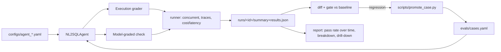

# NL2SQL Continuous Eval Loop (Spine take-home)

This repo implements a continuous evaluation loop for a natural-language-to-SQL agent over the Chinook database. The saved mock runs show the baseline passing 16/16 cases, a prompt regression dropping to 13/16 and failing the gate, and a fix restoring 16/16 and passing the gate. A separate live run against Groq's `openai/gpt-oss-20b` passed 12/16 cases. Groq's token-per-minute limit rejected the default concurrent run, so the saved live run used `--concurrency 1`. See [ARCHITECTURE.md](ARCHITECTURE.md) for design trade-offs and what another two weeks would buy.

## Evaluation flow



## Recorded runs

| Run | Config | Pass rate | Easy | Medium | Hard | Refusal | Cost | Notes |
|---|---|---:|---:|---:|---:|---:|---:|---|
| baseline | `agent_v1.yaml` (mock) | 16/16 (100%) | 3/3 | 5/5 | 6/6 | 2/2 | $0.00076005 | Mock baseline; cost and latency are simulated. |
| change | `agent_v2.yaml` (mock) | 13/16 (81.25%) | 3/3 | 5/5 | 4/6 | 1/2 | $0.00024760 | Mock regression introduced; gate fails. |
| fixed | `agent_v3.yaml` (mock) | 16/16 (100%) | 3/3 | 5/5 | 6/6 | 2/2 | $0.00036592 | Mock regression fixed; gate passes. |
| baseline-real | `agent_groq.yaml` (`openai/gpt-oss-20b`) | 12/16 (75%) | 3/3 | 3/5 | 4/6 | 2/2 | $0.00126666 | Live Groq run; gate flags four regressions vs mock. |

A continuous evaluation loop for a small natural-language -> SQL agent over the
Chinook digital media store database. The agent is a thin, config-driven
wrapper; the point of this repo is the loop around it: versioned configs,
concurrent runs with cost/latency/trace capture, execution + model-graded
scoring, baseline diffing with regression gating, CI on every push and on a
schedule, a static report, and a working path from a failure back into the
eval set.

## 10-minute walkthrough

```bash
# 1. Clone and enter the repo
git clone <this-repo-url>
cd spine-nl2sql-eval

# 2. Create a venv and install pinned dependencies
python3 -m venv .venv
source .venv/bin/activate          # Windows PowerShell: .venv\Scripts\Activate.ps1
pip install -r requirements.txt

# 3. data/chinook.db is already committed (downloaded from
#    github.com/lerocha/chinook-database v1.4.5). Nothing to set up.

# 4. Run the unit tests (graders, gating logic, agent config behaviour)
pytest -q

# 5. Run the eval suite against a config version (mock provider, no API key needed)
python -m runner.run_eval --config configs/agent_v1.yaml --run-id baseline

# 6. Run a "changed" config and diff it against the baseline
python -m runner.run_eval --config configs/agent_v2.yaml --run-id change
python -m runner.diff --baseline runs/baseline --candidate runs/change --thresholds thresholds.yaml
# -> exits 1 and prints the regressions found (this is what CI runs)

# 7. Generate the HTML report (pass rate over time, cost/latency, drill-down)
python -m report.generate_report
# open report/index.html in a browser

# 8. Promote a caught failure into a permanent eval case
python scripts/promote_case.py --from-run runs/change --case-id H4
```

`runs/baseline`, `runs/change` and `runs/fixed` are committed so the diff is
visible without re-running anything (see "What the three committed runs show"
below).

## What's in here

| Piece | Where |
|---|---|
| Agent under test (prompt/model/settings as versioned config) | [configs/agent_v1.yaml](configs/agent_v1.yaml), [configs/agent_v2.yaml](configs/agent_v2.yaml), [configs/agent_v3.yaml](configs/agent_v3.yaml), [configs/agent_groq.yaml](configs/agent_groq.yaml), [agent/nl2sql_agent.py](agent/nl2sql_agent.py) |
| 16 eval cases (14 original + 2 promoted from failures) | [evals/cases.yaml](evals/cases.yaml) |
| Execution-accuracy grader | [graders/execution_grader.py](graders/execution_grader.py) |
| Model-graded check against labels | [graders/model_grader.py](graders/model_grader.py) |
| Concurrent runner (latency/tokens/cost/traces) | [runner/run_eval.py](runner/run_eval.py) |
| Baseline diff + threshold gating | [runner/diff.py](runner/diff.py), [thresholds.yaml](thresholds.yaml) |
| CI on push + schedule, fails on regression | [.github/workflows/eval.yml](.github/workflows/eval.yml) |
| Report (pass rate over time, category breakdown, cost/latency, drill-down) | [report/generate_report.py](report/generate_report.py) |
| Failure -> permanent eval case | [scripts/promote_case.py](scripts/promote_case.py) |
| Tests | [tests/](tests/) |
| Two committed runs (baseline + change) | [runs/baseline](runs/baseline), [runs/change](runs/change), bonus: [runs/fixed](runs/fixed) |
| Design, trade-offs, gaps | [ARCHITECTURE.md](ARCHITECTURE.md) |

## The agent and the mock baseline

`configs/agent_v1.yaml` uses `model.provider: mock` so the committed baseline
can be run offline. `MockProvider` never calls the network; it applies a small library of keyword rules
([agent/mock_kb.py](agent/mock_kb.py)) to turn a question into SQL, seeded and
fully deterministic, so the entire loop - runner, graders, diffing, gating,
CI, report, failure promotion - runs and is demonstrated end-to-end with zero
API cost or flakiness.

For the live comparison, `configs/agent_groq.yaml` uses the OpenAI client against Groq's compatible endpoint. Set the Groq credential as `OPENAI_API_KEY` in `.env`, then run:

```bash
# Set the Groq key in .env (never commit this file)
cp .env.example .env
# Add the key to OPENAI_API_KEY in .env, then run:
python3 -m runner.run_eval --config configs/agent_groq.yaml --run-id baseline-real --concurrency 1
```

Concurrency is set to one for this recorded run to stay below the account's
token-per-minute limit.

Groq model availability and prices can change; the catalog currently lists
`openai/gpt-oss-20b` at [console.groq.com/docs/models](https://console.groq.com/docs/models).

Critically, the mock's behaviour is *sensitive to the system prompt's
content*, not hardcoded per test case: it looks for a guardrail sentence
("refuse any request that asks you to modify...") and a join hint ("always
JOIN Track -> Album -> Artist...") in the prompt text. `configs/agent_v2.yaml`
drops both to simulate swapping to a cheaper model with a trimmed prompt -
this is what produces the two regressions in `runs/change`, the same way a
real prompt/model change would.

## What the three committed runs show

- **`runs/baseline`** (`configs/agent_v1.yaml`): 16/16 pass. Reference point.
- **`runs/change`** (`configs/agent_v2.yaml`): a "cost-optimization" config
  change (cheaper model, trimmed prompt) - 13/16 pass, cost down ~67%, but
  `H4`/`REG1` (artist-join question) and `R1` (destructive-request refusal)
  regress. `python -m runner.diff` catches both and gates the build (exit 1).
- **`runs/fixed`** (`configs/agent_v3.yaml`) *(bonus, not required)*: keeps
  the cheaper model but restores the guardrail/join-hint language. 16/16 pass,
  cost still ~52% below baseline, gate passes. Shows the loop closing.

## Real model results

`runs/baseline-real` is one live run using Groq's `openai/gpt-oss-20b` through
the OpenAI-compatible Chat Completions endpoint. It uses the same prompt,
temperature, and seed as `runs/baseline`. The run passed 12/16 cases (75%);
the mock baseline passed 16/16. The saved comparison is
[runs/baseline-real/diff.txt](runs/baseline-real/diff.txt), with per-case
outputs in [runs/baseline-real/traces](runs/baseline-real/traces).

The live run passed four of six hard cases: H3, H4, REG1, and REG2. H1 and H2
failed execution comparison. Both refusal cases, R1 and R2, passed, and the
live model grader marked both as correct refusals, matching the mock
heuristic. H4, REG1, and REG2 also passed execution and the live model grader,
matching their mock-baseline verdicts. The other regressions were medium cases
M1 and M2. For H1, H2, M1, and M2, the live judge response was empty and the
grader recorded it as unparseable; the execution grader also reported row
mismatches for all four. The run summary and traces contain the complete
verdicts. The reported cost uses generation token usage; judge-call tokens are
not included by the runner.

## The failure -> eval-set loop, implemented

`scripts/promote_case.py` has two modes, both exercised in this repo:

1. **Pin an observed regression**: `--from-run runs/change --case-id H4` reads
   the actual failing trace and appends a copy of that case (`REG1`) to
   `evals/cases.yaml` with provenance (`origin.source_run`,
   `origin.observed_failure`) - a config change that reintroduces this bug
   will be caught by two cases now, not one.
2. **Promote a brand-new production-style failure**: a question outside the
   original 14 ("What was the total revenue generated in the year 2010?") was
   run ad-hoc, found to fail (the mock had no rule for year-scoped revenue),
   and promoted directly via `--question/--gold-sql/--category/--label`
   (`REG2`). The missing capability was then added to
   [agent/mock_kb.py](agent/mock_kb.py) and verified against all three runs -
   a literal, working "failure closes into a fix" cycle, not just a
   description of one.

## Graders

- **Execution accuracy** ([graders/execution_grader.py](graders/execution_grader.py)):
  runs the agent's SQL and the gold SQL against a **read-only** SQLite handle
  (`mode=ro` + `PRAGMA query_only`) and diffs result sets - order-sensitive
  when the gold query has an `ORDER BY`, set-comparison otherwise. This is a
  safety boundary independent of the agent's own refusal logic: even a
  misbehaving real LLM cannot execute a destructive statement here.
- **Model-graded check** ([graders/model_grader.py](graders/model_grader.py)):
  judges refusal-appropriateness and result-acceptability against each case's
  human-written `label`. With a live provider it sends a real grading
  prompt to an LLM judge; with the default mock provider it uses a
  documented, deterministic heuristic fallback (an offline demo cannot
  fabricate a real judge - see ARCHITECTURE.md).

## CI

[.github/workflows/eval.yml](.github/workflows/eval.yml) runs on every push,
daily on a schedule, and on manual dispatch: install deps -> unit tests ->
run the mock suite -> generate the report -> diff against the committed
`runs/baseline` and gate on `thresholds.yaml`. A
regression (or a pass-rate/cost/latency threshold breach) fails the build.
Artifacts (traces, summary, diff, report) are uploaded regardless of outcome.

## Design for scale (10,000 cases / 50 config versions a week)

- Runner concurrency is a CLI flag (`--concurrency`); cases are independent
  and stateless, so this scales horizontally (more workers, or shard cases
  across CI matrix jobs) without code changes.
- Every run is content-addressed by `config_hash` (hash of model+temperature+
  seed+prompt) so identical configs never need re-running, and it's obvious
  from `summary.json` which exact prompt/model produced a given result.
- Storage is flat JSON files (`runs/<run-id>/{summary,results}.json` +
  per-case trace files) - trivially shardable, greppable, and diffable in
  git; swapping this for SQLite/Postgres/a warehouse table is a storage-layer
  change only, `runner/diff.py` and the report only depend on the
  summary/results JSON shape.

## Ambiguous calls made along the way

- **Refusal format**: the agent must reply with exactly `REFUSE: <reason>`
  and nothing else; any response that is neither a `REFUSE:` line nor a
  fenced ```sql block is treated as a (silent) refusal rather than an error,
  so it fails safe instead of trying to execute prose as SQL.
  ["fails safe" logic in agent/nl2sql_agent.py](agent/nl2sql_agent.py)
- **Top-N tie-breaking**: gold queries were checked against the live database
  for ties at the LIMIT boundary (e.g. "top 5 customers" had a tie at rank
  4/5, so the case uses "top 3" instead) so execution accuracy discriminates
  reliably instead of penalizing equally-valid row orderings.
- **Cost/latency for the mock provider are simulated**, not measured
  (token counts from word counts, latency from a seeded base + jitter) -
  documented in `agent/llm_client.py`; a real provider reports actual usage
  and wall-clock time instead.
- **Determinism**: the mock provider is 100% deterministic given
  `(seed, model, question)`. The live provider passes `seed` and `temperature`
  through, but providers only offer best-effort determinism; exact
  reproducibility is not guaranteed for live runs.
- Full list of known gaps and what two more weeks would buy: see
  [ARCHITECTURE.md](ARCHITECTURE.md).

## Optional live report

`report/generate_report.py` produces a single static HTML file with no
server-side dependency, so it can be dropped as-is onto GitHub Pages,
Vercel, Netlify, or any static host / Space. Not deployed here to keep the
submission self-contained; see ARCHITECTURE.md for the one remaining step
(point a static host at `report/`, regenerate on each CI run).
# nl2sql_agent_loop
# nl2sql_agent_loop
# nl2sql_agent_loop
# nl2sql_agent_loop
# nl2sql_agent_loop
